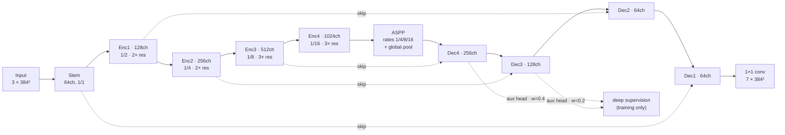

# Mechanical Parts Segmentation

Pixel-level segmentation of six mechanical component classes (hex nut, washer, bolt, ball bearing, spring, O-ring)


---

## Results

| | |
|---|---|
| **Best validation Dice** | 0.9695 (mean over 6 foreground classes) |
| **Model** | ScratchUNet — 100.6M parameters, no pretrained weights |
| **Training** | 60 epochs, ~1700 images, 2× Tesla T4, mixed precision |
| **Inference** | 8-fold dihedral TTA, RLE-encoded submission |


*Raw per-epoch logs are available in [`assets/training_history.csv`](assets/training_history.csv).*

---

## The Problem

The dataset contains 2,000 training images and 500 test images at 384×384 resolution. The task is to classify every pixel into one of 7 classes (background + 6 part types) and evaluate using the Dice score on the foreground classes. 


A few quirks in the data dictated my approach:

1. **Massive background imbalance.** Background takes up about 76% of all pixels. If you use standard cross-entropy, the model gets lazy, predicts background everywhere, and still looks decent on paper. I had to use a region-based loss.
2. **Super thin structures.** Springs and O-rings are only a few pixels wide. If the network downsamples too aggressively, these classes completely disappear. They require a balance of fine detail and wide context.
3. **Rotational invariance.** The parts are scattered on a flat tray at random angles. This means standard dihedral augmentations (flips + 90° rotations) are a free, label-preserving way to multiply the dataset, which also translates perfectly to Test-Time Augmentation (TTA).

---

## My Approach

### Architecture

I built a U-Net entirely from scratch instead of relying on an ImageNet backbone. Since the images are synthetic renders on a plain tray, pretrained weights didn't buy me much. Writing the encoder from scratch gave me total control over depth, dilation rates, and where to attach deep supervision.



A few specific design decisions:

*   **ASPP at the bottleneck:** At 1/16 resolution, the feature map shrinks to 24×24. Using parallel dilated convolutions (rates 1, 4, 8, 16) plus a global-average branch lets a single position "see" everything from a small washer rim to the entire tray. This avoided a fifth downsampling step that would have destroyed the thin spring classes.
*   **Residual blocks everywhere:** I used two 3×3 convolutions with an identity skip (2–3 per stage). When you're training a 100M-parameter model from random initialization, you desperately need the clean gradient flow that residual connections provide.
*   **Deep supervision:** I added auxiliary 1×1 heads on decoder stages 4 and 3, upsampled them to full resolution, and supervised them with weights of 0.4 and 0.2. This pushes a direct gradient to the deeper layers rather than routing everything through the entire decoder. They turn off during inference, so they don't slow down predictions.

*Note on BatchNorm: I dropped the momentum to 0.01 (from the 0.1 default). With a batch size of 16, the running stats were too noisy, causing validation accuracy to lag noticeably behind training accuracy.*

### Loss Function

```python
L = Dice(foreground only) + Focal(γ=2)
```

I summed Soft Dice and Focal loss because they solve different problems. Dice directly optimizes the competition metric (region overlap) and ignores the massive background bias. Focal loss works on a per-pixel level, aggressively punishing the model for getting the hard pixels wrong—specifically object boundaries and the empty gaps between spring coils. 

Neither works well in isolation here. Dice gradients are horribly unstable early in training, and cross-entropy heavily favors the background. Combined, they train smoothly right from a random initialization.

### Training Setup

| Setting | Value |
|---|---|
| Optimiser | AdamW, lr 3e-4, weight decay 1e-4 |
| Schedule | CosineAnnealingWarmRestarts, `T_0=15`, `T_mult=2`, `eta_min=1e-6` |
| Precision | AMP (`float16` autocast + `GradScaler`) |
| Gradient clipping | global norm 1.0 |
| Batch size | 16 |
| Epochs | 60 |
| Split | 85 / 15 random, seed 42 |

**Augmentations (Albumentations):** Flips, 90° rotations, shift-scale-rotate, elastic/grid distortion, brightness/contrast, hue/saturation, CLAHE, Gaussian noise/blur, and coarse dropout. The warping augmentations were actually crucial. Without them, the model just memorized the rigid shapes of the springs and O-rings instead of learning their actual textures. Coarse dropout forced the network to rely on surrounding context rather than easily matching whole objects.

### Test-Time Augmentation (TTA)

I reused the dihedral symmetry for inference. Every test image goes through the model 8 times (all flip and 90° rotation combos). The resulting probability maps are inversely transformed and averaged. 

I made sure to average the probabilities in **softmax space**, not the hard argmax labels. Averaging hard labels throws away the confidence data, which completely defeats the purpose of ensembling.

---

## Repo Layout

```text
├── configs/default.yaml            # Master config for the submitted run
├── notebooks/
│   └── nppe1_semantic_segmentation.ipynb   # Original Kaggle notebook
├── src/
│   ├── config.py                   # Typed YAML config loader
│   ├── constants.py                # Class IDs, colors, norm stats
│   ├── rle.py                      # Column-major run-length encoding
│   ├── data/
│   │   ├── dataset.py              # SegmentationDataset and splits
│   │   └── transforms.py           # Albumentations pipelines
│   ├── models/
│   │   ├── blocks.py               # ConvBnAct, ResBlock, ASPP, etc.
│   │   └── unet.py                 # ScratchUNet definition
│   ├── losses.py                   # Dice, Focal, and Combined loss
│   ├── metrics.py                  # Foreground Dice calculator
│   ├── engine.py                   # Train and validation loops
│   ├── tta.py                      # 8-fold dihedral TTA logic
│   ├── train.py                    # Training entry point
│   ├── predict.py                  # Inference entry point -> submission.csv
│   └── evaluate.py                 # Validation eval -> per-class Dice
├── scripts/
│   ├── build_notebook.py           # Recompiles the Kaggle notebook
│   └── make_figures.py             # Generates the charts in this README
├── tests/
│   ├── test_rle.py                 # Tests RLE encode/decode round-trips
│   ├── test_tta.py                 # Verifies inverse transforms map correctly
│   └── test_model.py               # Checks head shapes and gradient flow
└── assets/                         # Charts and training logs
```

---

## Usage

```bash
git clone https://github.com/ManishSahani24/mechanical-parts-segmentation.git
cd mechanical-parts-segmentation
pip install -r requirements.txt
```

Download the Kaggle competition data and point `configs/default.yaml` to it. The code expects this structure:

```text
data/Dataset/
├── train/images/*.png
├── train/masks/*.png
├── test/images/*.png
└── sample_submission.csv
```

**Commands:**

```bash
# Run training (saves to outputs/best_model.pth and outputs/history.csv)
python -m src.train --config configs/default.yaml

# Evaluate per-class Dice on the validation split (with/without TTA)
python -m src.evaluate --checkpoint outputs/best_model.pth --compare-tta

# Generate the final Kaggle submission
python -m src.predict --checkpoint outputs/best_model.pth --out outputs/submission.csv

# Run unit tests
pytest tests/
```

---

## Acknowledgements

Dataset provided by the [DL & Gen AI course semantic segmentation](https://www.kaggle.com/competitions/nppe-1-dl-gen-ai-course-semantic-segmentation) competition on Kaggle.

Licensed under the MIT License — see [LICENSE](LICENSE) for details.
