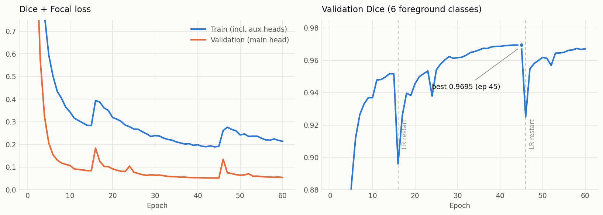
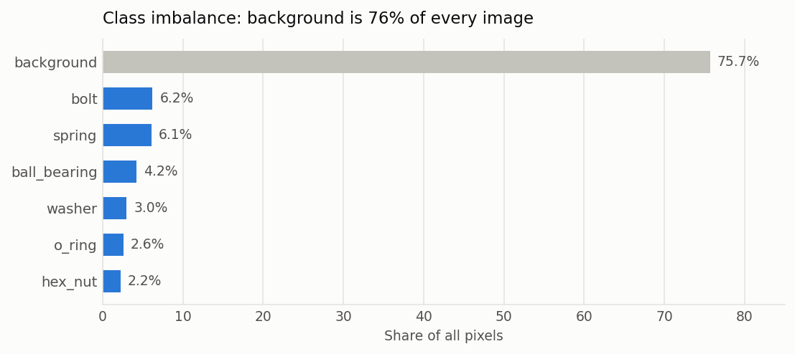
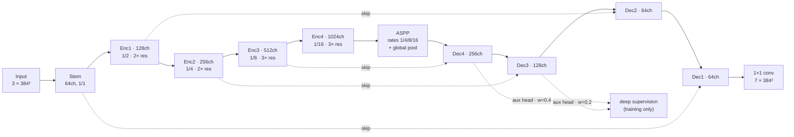

# Mechanical Parts Segmentation

Pixel-level segmentation of six mechanical component classes — hex nut, washer, bolt, ball bearing, spring, O-ring — using a U-Net trained from scratch in PyTorch.

Built for the **NPPE-1 Deep Learning & Gen AI** Kaggle competition. **Rank 108 / 708.** Best validation Dice **0.9695**.


---

## Results

| | |
|---|---|
| **Leaderboard rank** | 108 / 708 |
| **Best validation Dice** | 0.9695 (mean over 6 foreground classes) |
| **Model** | ScratchUNet — 100.6M parameters, no pretrained weights |
| **Training** | 60 epochs, ~1700 images, 2× Tesla T4, mixed precision |
| **Inference** | 8-fold dihedral TTA, RLE-encoded submission |



*Left: Dice+Focal loss. The training curve includes the two auxiliary heads, so it sits above validation by construction — the two are not directly comparable. The y-axis is clipped at 0.75; epoch 1 validation loss was 15.1. Right: validation Dice, clipped at 0.88 (epochs 1–4 are below the axis). Both dips line up exactly with the cosine warm restarts — see [Honest notes](#honest-notes).*

Raw per-epoch numbers: [`assets/training_history.csv`](assets/training_history.csv).

---

## The problem

2,000 training images and 500 test images at 384×384. Each pixel belongs to one of 7 classes: background plus the six component types. Scoring is Dice over the foreground classes; submissions are run-length encoded per (image, class) pair.



Three things about this data shaped the design:

1. **Background dominates.** At 76% of all pixels, a model optimised with plain cross-entropy drifts toward predicting background everywhere and still looks good on paper. The loss has to be region-based.
2. **Two classes are thin structures.** Springs and O-rings are coils and rings a few pixels wide. Downsampling too aggressively erases them; they need both fine detail and wide context.
3. **There is no canonical orientation.** Parts sit on a flat tray at arbitrary angles, which makes the full dihedral group (flips + 90° rotations) a free, label-preserving augmentation — and the same trick works again at inference time as TTA.

---

## Approach

### Architecture

A U-Net written from scratch — no ImageNet backbone. The images are synthetic renders of machined parts on a plain tray, so pretrained low-level filters buy little, and building the encoder myself left every choice (depth, width, dilation rates, where to attach auxiliary supervision) free to tune.



Three design choices worth naming:

**ASPP at the bottleneck.** At 1/16 resolution the feature map is 24×24. Parallel dilated convolutions (rates 1, 4, 8, 16) plus a global-average branch let a single position see anything from a washer's rim to the entire tray, without a fifth downsample that would have cost the thin classes their detail.

**Residual blocks throughout the encoder.** Two 3×3 convs with an identity skip, 2–3 per stage. Training a 100M-parameter network from random init needs the gradient path that residual connections provide.

**Deep supervision.** Auxiliary 1×1 heads on decoder stages 4 and 3, upsampled to full resolution and supervised with the same loss at weights 0.4 and 0.2. They give the deep layers a direct gradient instead of one routed through the whole decoder. They are active only in `train()` mode, so inference cost is unchanged.

`BatchNorm` uses `momentum=0.01` rather than the 0.1 default — at batch size 16 the running statistics are noisy enough that eval-mode accuracy otherwise lags train-mode by a visible margin.

### Loss

```
L = Dice(foreground only) + Focal(γ=2)
```

The two terms fix different failure modes. **Soft Dice** optimises region overlap directly — it is the competition metric, and it is blind to the 76% background prior. **Focal loss** is a per-pixel term that keeps pushing on the small set of genuinely hard pixels, mostly object boundaries and the gaps between spring coils, long after Dice has flattened.

Neither works alone here: Dice by itself gives unstable gradients in the first few epochs when predictions are near-uniform, and cross-entropy by itself converges to a background-heavy solution. The sum trains smoothly from random init, which matters a lot when there is no pretrained encoder to fall back on.

### Training recipe

| Setting | Value |
|---|---|
| Optimiser | AdamW, lr 3e-4, weight decay 1e-4 |
| Schedule | CosineAnnealingWarmRestarts, `T_0=15`, `T_mult=2`, `eta_min=1e-6` |
| Precision | AMP (`float16` autocast + `GradScaler`) |
| Gradient clipping | global norm 1.0 |
| Batch size | 16 |
| Epochs | 60 |
| Split | 85 / 15 random, seed 42 |

Augmentation (albumentations): horizontal/vertical flips and 90° rotations; shift-scale-rotate; elastic and grid distortion; one of brightness-contrast / hue-saturation / CLAHE; Gaussian noise and blur; coarse dropout. The warps matter more than they look — without them the model learns spring and O-ring by shape template rather than by texture, and coarse dropout forces it to use surrounding context instead of matching whole objects.

### Test-time augmentation

The same dihedral symmetry that made augmentation free applies at inference. Each test image is predicted under all 8 views, each probability map is mapped back through the inverse transform, and the 8 are averaged.

Averaging happens in **softmax probability space**, not on argmax labels — averaging hard labels would discard exactly the confidence information that makes the ensemble worth anything.

---

## Repository layout

```
├── configs/default.yaml            # every hyper-parameter of the submitted run
├── notebooks/
│   └── nppe1_semantic_segmentation.ipynb   # the original Kaggle notebook
├── src/
│   ├── config.py                   # typed config loaded from YAML
│   ├── constants.py                # class ids, names, colours, normalisation stats
│   ├── rle.py                      # run-length encode/decode (column-major)
│   ├── data/
│   │   ├── dataset.py              # SegmentationDataset, split, dataloaders
│   │   └── transforms.py           # albumentations pipelines
│   ├── models/
│   │   ├── blocks.py               # ConvBnAct, ResBlock, EncoderBlock, ASPP, DecoderBlock
│   │   └── unet.py                 # ScratchUNet
│   ├── losses.py                   # Dice, Focal, Combined
│   ├── metrics.py                  # foreground Dice
│   ├── engine.py                   # train / validate loops
│   ├── tta.py                      # 8-fold dihedral TTA
│   ├── train.py                    # entry point
│   ├── predict.py                  # entry point → submission.csv
│   └── evaluate.py                 # entry point → per-class Dice, TTA delta
├── scripts/
│   ├── build_notebook.py           # regenerates the notebook
│   └── make_figures.py             # regenerates the README charts from the run log
├── tests/
│   ├── test_rle.py                 # encode/decode round-trip, column-major order
│   ├── test_tta.py                 # all 8 views distinct, every inverse round-trips
│   └── test_model.py               # head shapes, train/eval contract, gradients
└── assets/                         # charts + per-epoch training log
```


---

## Usage

```bash
git clone https://github.com/ManishSahani24/mechanical-parts-segmentation.git
cd mechanical-parts-segmentation
pip install -r requirements.txt
```

Download the competition data and point `configs/default.yaml` at it. The expected layout is:

```
data/Dataset/
├── train/images/*.png
├── train/masks/*.png
├── test/images/*.png
└── sample_submission.csv
```

```bash
# Train (writes outputs/best_model.pth and outputs/history.csv)
python -m src.train --config configs/default.yaml

# Per-class Dice on the held-out split, with and without TTA
python -m src.evaluate --checkpoint outputs/best_model.pth --compare-tta

# Generate a submission
python -m src.predict --checkpoint outputs/best_model.pth --out outputs/submission.csv

# Tests
pytest tests/
```


---


## Acknowledgements

Dataset from the [DL & Gen AI course semantic segmentation](https://www.kaggle.com/competitions/nppe-1-dl-gen-ai-course-semantic-segmentation) competition on Kaggle.

Licensed under the MIT License — see [LICENSE](LICENSE).
